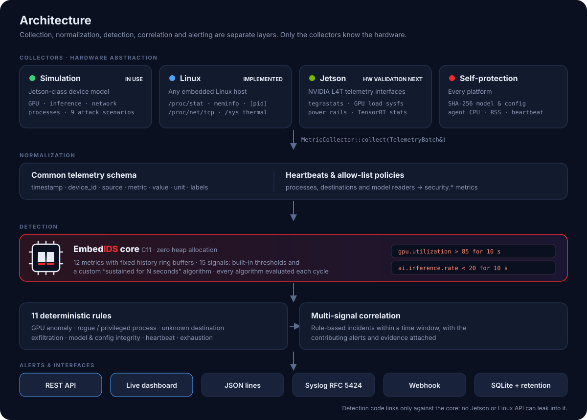
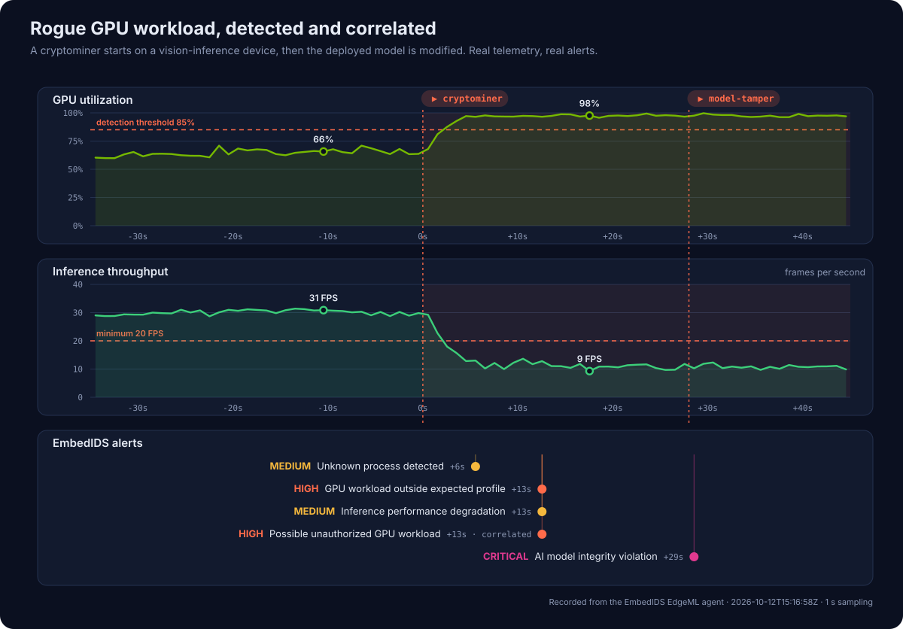
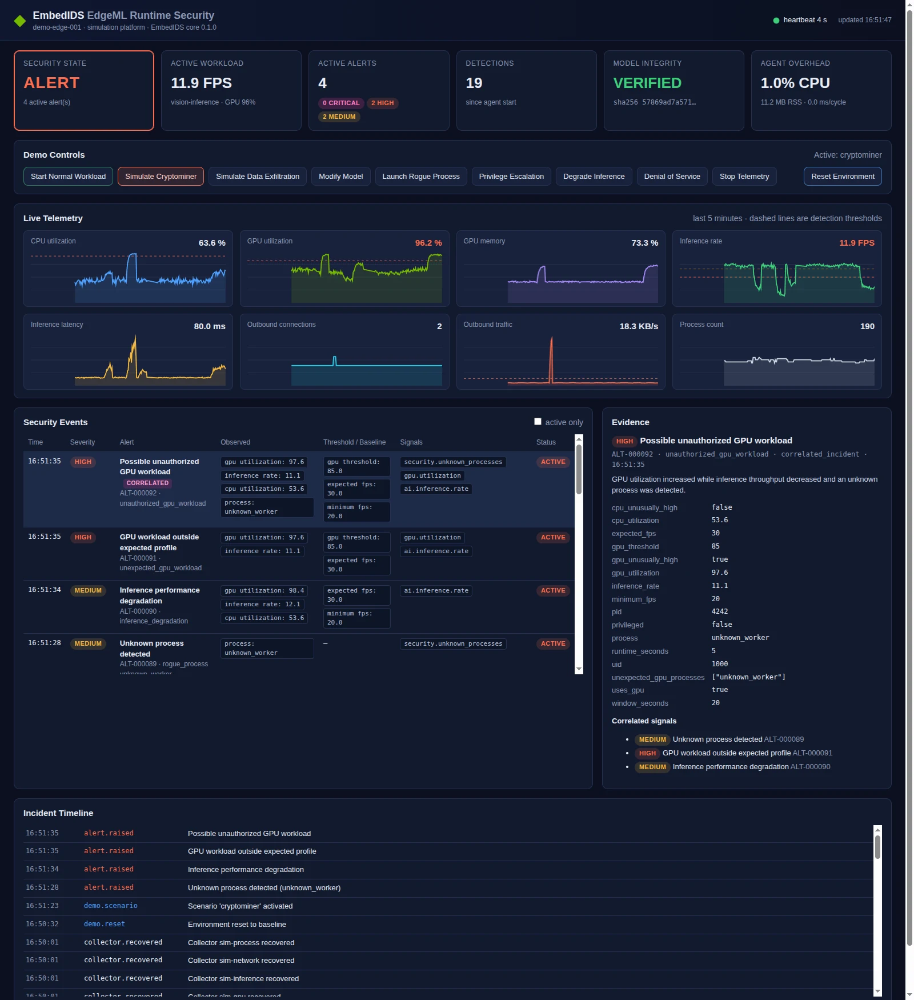
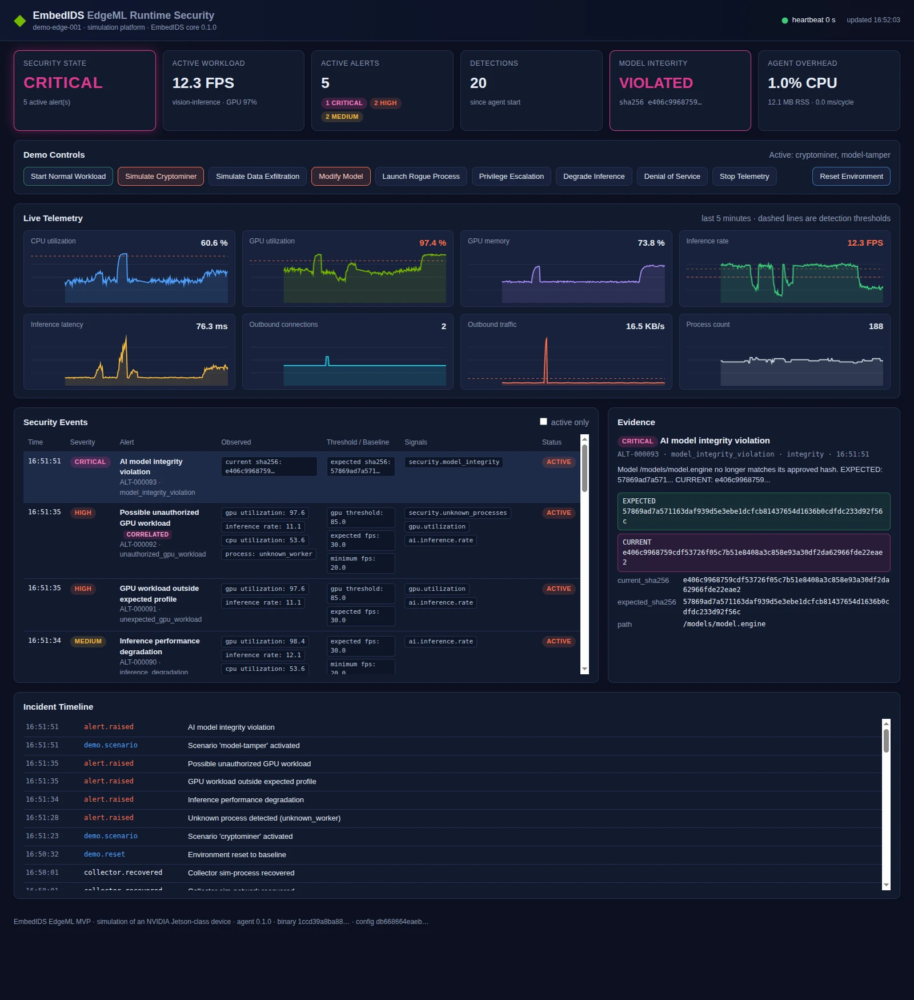
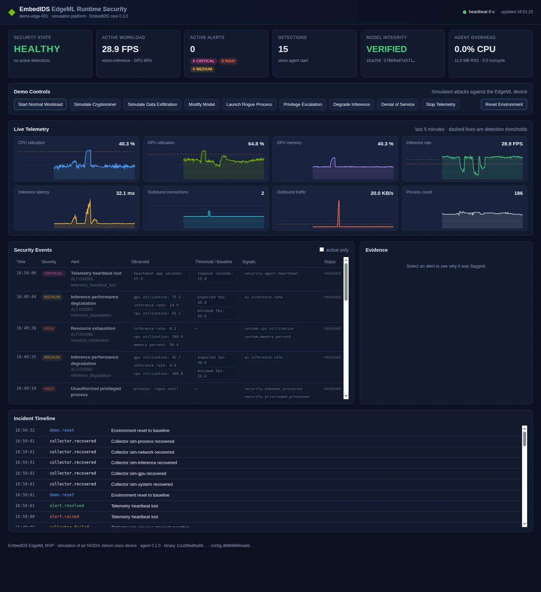
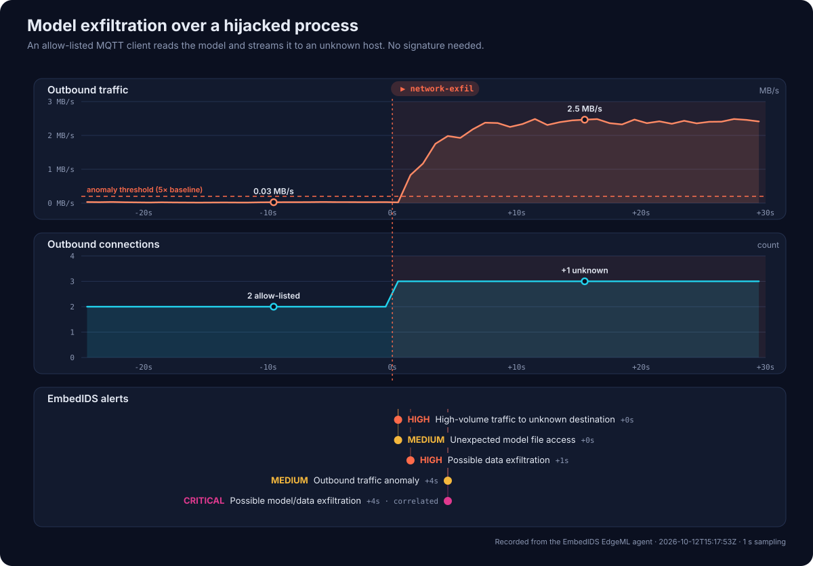
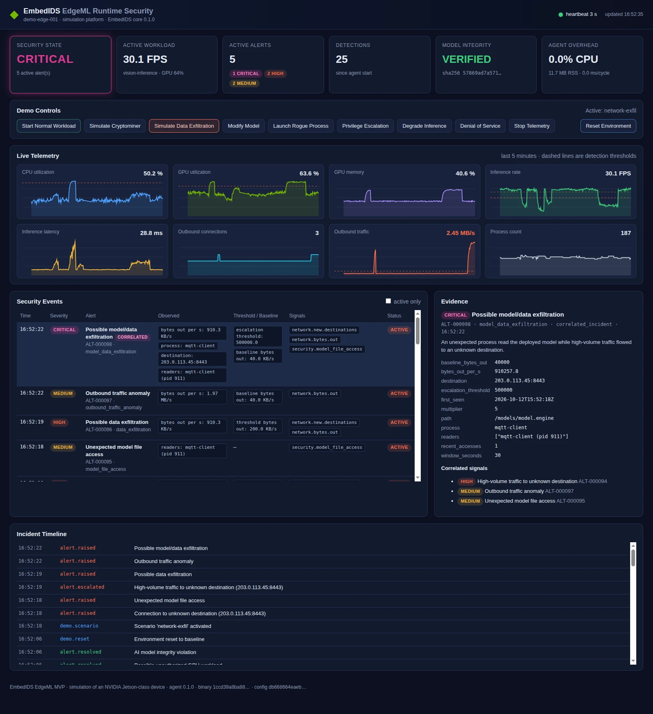
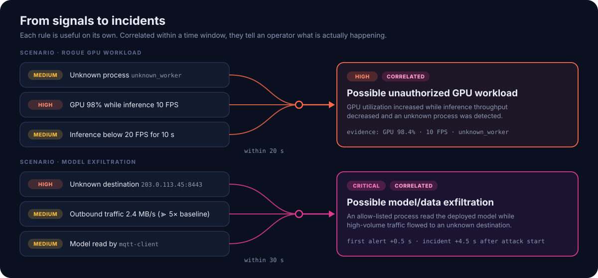
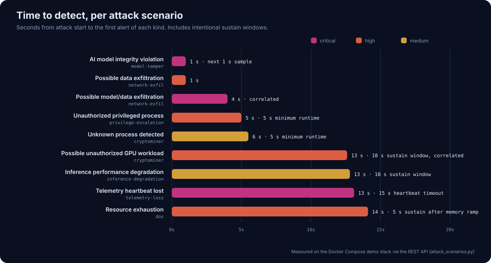
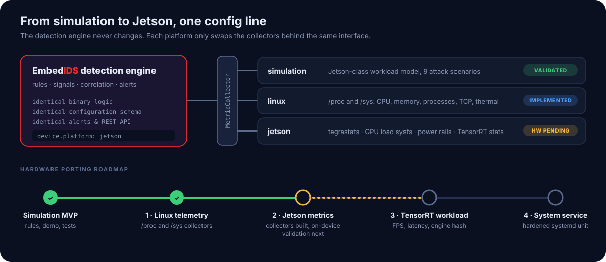

# Runtime security for Edge AI devices

**How EmbedIDS EdgeML catches rogue GPU workloads, model tampering and data
exfiltration on a vision-inference device, in seconds, from about 9 MB of
memory.**

{ .off-glb fetchpriority=high width="1200" height="440" }

<div class="grid cards" markdown>

-   :material-target:{ .lg .middle } __The challenge__

    ---

    Edge AI devices run valuable models on shared GPUs, in the field, often
    offline. Traditional endpoint agents are heavy, signature-driven and blind
    to what matters here: *is the AI workload still behaving like itself?*

-   :material-shield-search:{ .lg .middle } __The approach__

    ---

    An on-device agent built on the EmbedIDS core watches the compute,
    the inference pipeline, the deployed model, processes and network.
    It correlates them into incidents an operator can act on.

-   :material-chart-timeline-variant-shimmer:{ .lg .middle } __The result__

    ---

    Nine attack scenarios detected end to end, with model tampering flagged
    within **1 s**. No false alarms over 250 simulated minutes. The agent
    uses **~0.5 % CPU and ~9 MB RAM**.

</div>

!!! info "Scope of this study"

    This case study covers the **EmbedIDS EdgeML MVP**, an open-source
    reference implementation. It runs against a high-fidelity simulation of an
    NVIDIA Jetson-class device running a computer-vision inference workload.

    - All numbers are engineering measurements from that environment, not
      hardware benchmarks.
    - The same detection engine ships with Linux and Jetson collectors.
    - On-device Jetson validation is the next milestone
      ([see the roadmap](#path-to-nvidia-jetson)).

---

## The challenge

A camera on a factory line or a retail shelf feeds frames to a TensorRT
model on an embedded GPU. The device is unattended, often behind NAT, and
updated rarely. Attacks against it don't look like attacks against a laptop:

| Threat | What actually happens on the device |
|--------|-------------------------------------|
| **GPU hijacking** (cryptominers, rogue CUDA jobs) | GPU pinned near 100 %, legitimate inference throughput collapses |
| **Model tampering** | The engine file on disk changes; the device keeps "working" with backdoored outputs |
| **Model or data theft** | A process that is allowed to run reads the model and streams it out |
| **Privilege escalation** | A root shell appears among a handful of known services |
| **Denial of service** | CPU and memory exhausted, inference stalls |
| **Blinding the defender** | The security telemetry quietly stops |

Most of these leave **no malware signature** to match. But every one of them
changes how an Edge AI device *behaves*. That is the signal EmbedIDS uses.

## The approach: security designed around AI workload behavior

Instead of installing a traditional endpoint agent on an edge AI device,
EmbedIDS EdgeML models what *normal* looks like for the AI workload itself:

<div class="grid cards" markdown>

-   :material-expansion-card-variant:{ .lg .middle } __Compute behavior__

    ---

    GPU and CPU utilization, GPU memory, power and temperature against the
    workload's expected profile.

-   :material-camera-iris:{ .lg .middle } __AI workload health__

    ---

    Inference FPS, latency, errors and pipeline health against the 30 FPS
    baseline.

-   :material-fingerprint:{ .lg .middle } __Model integrity__

    ---

    SHA-256 of the deployed engine against its approved hash, and who reads
    the model file.

-   :material-lan-connect:{ .lg .middle } __Process & network behavior__

    ---

    Allow-listed processes and destinations, privileged processes and
    outbound volume.

</div>

Every one of these becomes a numeric metric in a common schema. The
**EmbedIDS core**, a C11 library with zero heap allocation, evaluates them
against thresholds and "sustained for N seconds" conditions every second.

## Architecture

{ loading=lazy width="1200" height="860" }

- **Collectors are the only hardware-aware layer.** Simulation, generic
  Linux (`/proc`, `/sys`) and NVIDIA Jetson (`tegrastats`, GPU sysfs) all
  implement the same `MetricCollector` interface.
- **Detection is deterministic and explainable.** There are 11 rules, and
  every alert carries the observed values, the thresholds it crossed and the
  metrics involved.
- **Correlation turns alerts into incidents.** Three rule-based patterns
  combine individual alerts that fire inside a time window.
- **Standard outputs.** Alerts go to a REST API and live dashboard, JSON
  lines, RFC 5424 syslog, webhooks and a local SQLite store with rolling
  retention.

## Seeing it work

### Scenario A: a cryptominer hijacks the GPU

A rogue process, `unknown_worker`, starts on the device and saturates the
GPU. Inference throughput drops from 30 FPS to around 10 FPS. Later in the
same run, the deployed model file is modified.

{ loading=lazy width="1200" height="836" }

The chart above is **recorded telemetry, not an illustration**. Here is what
EmbedIDS saw:

1. **+6 s**: an unknown process has been running for longer than the 5 s
   grace period → `MEDIUM` *Unknown process detected*.
2. **+13 s**: the GPU stays above 85 % while inference stays below baseline
   for the full 10 s sustain window → `HIGH` *GPU workload outside expected
   profile* and `MEDIUM` *Inference performance degradation*.
3. **Same cycle**: the three signals fall inside the 20 s correlation window
   → `HIGH` correlated incident **Possible unauthorized GPU workload**.
4. **+29 s**, one second after the model file was modified → `CRITICAL`
   **AI model integrity violation**.

The 10 s sustain window is deliberate: a legitimate burst of GPU work never
pages anyone.

=== "Correlated incident"

    { loading=lazy width="1600" height="1750" }

=== "Model integrity violation"

    { loading=lazy width="1600" height="1750" }

=== "Healthy baseline"

    { loading=lazy width="1600" height="1750" }

Every alert explains itself. This is the correlated incident exactly as the
agent's REST API returned it:

```json title="GET /alerts/ALT-000067"
{
  "alert_id": "ALT-000067",
  "timestamp": "2026-10-12T15:16:26Z",
  "device_id": "demo-edge-001",
  "severity": "high",
  "category": "correlated_incident",
  "rule": "unauthorized_gpu_workload",
  "title": "Possible unauthorized GPU workload",
  "description": "GPU utilization increased while inference throughput decreased and an unknown process was detected.",
  "evidence": {
    "gpu_utilization": 96.5,
    "inference_rate": 12.8,
    "process": "unknown_worker",
    "window_seconds": 20,
    "correlated_alerts": [
      "ALT-000064 rogue_process",
      "ALT-000065 unexpected_gpu_workload",
      "ALT-000066 inference_degradation"
    ]
  },
  "signals": ["security.unknown_processes", "gpu.utilization", "ai.inference.rate"]
}
```

### Scenario B: the AI model is tampered with

Model tampering is the attack with the highest stakes and the least visible
symptoms. In this scenario 4 KB of the TensorRT engine are overwritten on
disk. The agent re-hashes the file whenever its size, modification time or
inode changes, and on a schedule as a safety net, so the change is caught on
the very next sample:

```text
[CRITICAL] AI model integrity violation
EXPECTED: 57869ad7a571163daf939d5e3ebe1dcfcb81437654d1636b0cdfdc233d92f56c
CURRENT:  e406c9968759cdf53726f05c7b51e8408a3c858e93a30df2da62966fde22eae2
```

The configuration file and the agent binary are protected the same way.
Editing the agent's own configuration on a running device raises a
*Configuration integrity violation*.

### Scenario C: model exfiltration through a trusted process

This attacker is quieter. Nothing new is launched: the allow-listed
`mqtt-client` reads the model and streams it to an unknown host. A
process allow list alone would miss it entirely.

{ loading=lazy width="1200" height="836" }

Within **half a second**, EmbedIDS flags two things:

- the connection to `203.0.113.45:8443`, escalated to `HIGH` because of its
  volume;
- the unexpected read of the model file.

By **+4.5 s** the sustained outbound anomaly confirms the pattern, and the
three signals correlate into a `CRITICAL` **Possible model/data
exfiltration** incident.

{ loading=lazy width="1600" height="1750" }

### More scenarios

| Scenario | What the attacker does | What EmbedIDS raises |
|----------|------------------------|----------------------|
| Privilege escalation | Spawns `rogue-shell` as UID 0 | `HIGH` Unauthorized privileged process |
| Denial of service | CPU to 100 %, memory to 95 %, inference to 5 FPS | `HIGH` Resource exhaustion, `MEDIUM` Inference degradation |
| Inference degradation | Throughput falls to ~14 FPS with no rogue process | `MEDIUM` Inference performance degradation |
| Agent tampering | Security telemetry stops | `CRITICAL` Telemetry heartbeat lost: *"Security telemetry unavailable. Possible collector failure or tampering."* |
| Combined attack | Privilege escalation and DoS together | `CRITICAL` correlated *Privileged process exhausting device resources* |

## From signals to incidents

{ loading=lazy width="1200" height="560" }

Correlation is rule-based and configured in YAML, so it stays predictable
and auditable:

```yaml title="/etc/embedids/config.yaml"
correlations:
  - name: unauthorized_gpu_workload
    severity: high
    window_seconds: 20
    requires:
      - security.unknown_processes
      - gpu.utilization
      - ai.inference.rate
```

## Results

{ loading=lazy width="1200" height="644" }

<div class="grid cards" markdown>

-   :material-timer-outline:{ .lg .middle } __1 s__

    ---

    Model tampering to `CRITICAL` alert: the next 1 s sample. The target was
    under 2 s.

-   :material-check-decagram:{ .lg .middle } __0 false alarms__

    ---

    Over 250 minutes of normal operation across 25 randomized workload
    seeds.

-   :material-memory:{ .lg .middle } __~9 MB · ~0.5 % CPU__

    ---

    Agent footprint at 1 s sampling, including the REST API serving the live
    dashboard.

-   :material-flash-outline:{ .lg .middle } __≤ 3 ms__

    ---

    Per-cycle detection, correlation and alerting time. The target was under
    100 ms.

</div>

| Measure | Target | Measured |
|---------|--------|----------|
| Agent CPU overhead | < 5 % | ~0.5 % of one core |
| Agent memory | < 100 MB | ~8-10 MB RSS |
| Processing latency per cycle | < 100 ms | ≤ 3 ms |
| Alert generation after detection | < 1 s | same cycle |
| Model tamper detection | < 2 s | 1 s |
| High-severity alerts in normal operation | 0 | 0 |

The release is backed by an automated test suite:

- 112 unit and integration tests, including every scenario replayed on a
  deterministic virtual clock;
- an end-to-end suite that drives real agent and simulator processes through
  all attacks;
- the same acceptance suite run against the Docker Compose stack.

## Built to live on the device

- **Lean by design.** The detection core is the EmbedIDS C library: fixed
  history buffers and zero heap allocation. The agent bounds its own threads
  and allocator arenas so it stays at a few megabytes.
- **Least privilege.** The agent runs as a dedicated `embedids` user with no
  Linux capabilities, a read-only filesystem, a hardened systemd unit and
  resource limits.
- **Self-protecting.** The agent checks:

    - its configuration, hashed at startup and re-checked continuously;
    - its own binary hash, which is exposed for attestation;
    - per-collector heartbeats.

    It is restarted automatically if it ever crashes.

- **Explainable.** Every alert records which metric crossed which threshold
  and for how long, with the contributing alerts attached.

## Path to NVIDIA Jetson

{ loading=lazy width="1200" height="520" }

Moving from simulation to hardware is a configuration change, not a rewrite:

```yaml
device:
  platform: jetson   # simulation | linux | jetson
```

| Phase | Status | Scope |
|-------|--------|-------|
| Simulation MVP | :material-check-circle:{ style="color: #3ccf7a" } Done | Rules, correlation, dashboard, tests |
| 1 · Linux telemetry | :material-check-circle:{ style="color: #3ccf7a" } Done | `/proc` and `/sys` collectors, verified on a live Linux host |
| 2 · Jetson metrics | :material-progress-clock:{ style="color: #f5b83d" } Built, validation next | `tegrastats` and GPU sysfs collectors, parser tested on JetPack 4 and 6 output |
| 3 · TensorRT workload | :material-circle-outline: Planned | FPS, latency, errors and engine hash from the inference pipeline |
| 4 · System service | :material-circle-outline: Planned | Hardened systemd unit (already included) on a fielded device |

Beyond the MVP, the roadmap includes:

- statistical baselines (EWMA, standard deviation);
- eBPF and auditd collectors;
- TensorRT engine provenance;
- secure-boot and TPM attestation status;
- fleet-level management.

## Try it yourself

The full demo runs on any laptop with Docker. No NVIDIA hardware is
required.

=== "Docker Compose"

    ```bash
    git clone https://github.com/Linuscent/EmbedIDS.git
    cd EmbedIDS/edgeml/deployment
    docker compose up --build -d
    # open http://localhost:8080 and press "Simulate Cryptominer"
    ```

=== "Single binary"

    ```bash
    git clone https://github.com/Linuscent/EmbedIDS.git && cd EmbedIDS
    cmake -S . -B build -DBUILD_EDGEML=ON && cmake --build build -j
    ./build/edgeml/embedids-agent --config edgeml/configs/default.yaml
    # open http://localhost:8080
    ```

=== "Scripted attacks"

    ```bash
    edgeml/simulator/attacks/attack.sh cryptominer      # inject and watch alerts
    edgeml/simulator/attacks/demo_walkthrough.sh        # paced 5-stage demo
    python3 edgeml/tests/attack-scenarios/attack_scenarios.py   # acceptance run
    ```

The engineering documentation covers the
[architecture](https://github.com/Linuscent/EmbedIDS/blob/main/edgeml/docs/architecture.md),
the [demo guide](https://github.com/Linuscent/EmbedIDS/blob/main/edgeml/docs/demo-guide.md),
the [REST API](https://github.com/Linuscent/EmbedIDS/blob/main/edgeml/docs/api.md)
and [hardware porting](https://github.com/Linuscent/EmbedIDS/blob/main/edgeml/docs/hardware-port.md).
It is all in the [`edgeml/`](https://github.com/Linuscent/EmbedIDS/tree/main/edgeml)
directory of the EmbedIDS repository.

!!! tip "Building on Edge AI hardware?"

    We're looking for early adopters to validate EmbedIDS EdgeML on fielded
    Jetson devices. [Get in touch on LinkedIn](https://www.linkedin.com/company/linuscent)
    or [open an issue](https://github.com/Linuscent/EmbedIDS/issues).

---

<small>
Measurements were taken on the EmbedIDS EdgeML Docker Compose demo
(x86-64 host, 1 s sampling) in October 2026. The charts are rendered from
telemetry recorded from the running agent with
`edgeml/tools/case_study_charts.py`.

NVIDIA, Jetson and TensorRT are trademarks of NVIDIA Corporation. This case
study describes a simulation of a Jetson-class device and does not imply
endorsement by NVIDIA.
</small>
