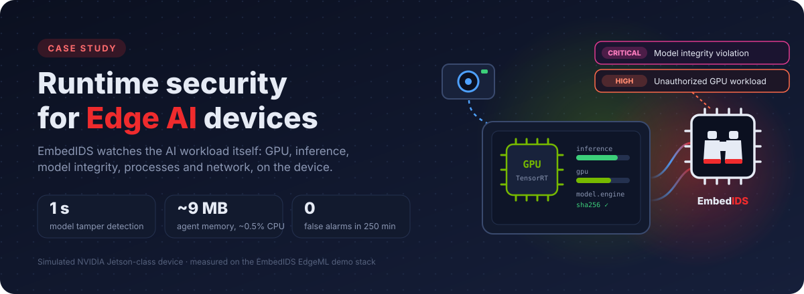

# Case studies

How EmbedIDS is applied to concrete embedded and edge security problems, with
the measurements to back it up.

-   :material-chip:{ .lg .middle } __Runtime security for Edge AI devices__

    ---

    { .off-glb }

    EmbedIDS EdgeML detects rogue GPU workloads, AI model tampering and
    model exfiltration on a Jetson-class vision-inference device. It flags
    model tampering in 1 s and runs in about 9 MB of memory.

    [:octicons-arrow-right-24: Read the case study](edgeml-runtime-security.md)

