How EmbedIDS is applied to concrete embedded and edge security problems, with
the measurements to back it up.

## Runtime security for Edge AI devices

EmbedIDS EdgeML detects rogue GPU workloads, AI model tampering and
model exfiltration on a Jetson-class vision-inference device. It flags
model tampering in 1 s and runs in about 9 MB of memory.

[Read the Edge AI runtime security case study](edgeml-runtime-security.mdx)

## Runtime security on Zephyr RTOS

EmbedIDS runs inside Zephyr firmware as an optional module, with a bounded
sample queue and one detector thread. In simulation it flags command abuse,
request floods, tampering and telemetry loss within 120 ms, using 640 bytes
of metric history.

[Read the Zephyr runtime security case study](zephyr-runtime-security.mdx)
