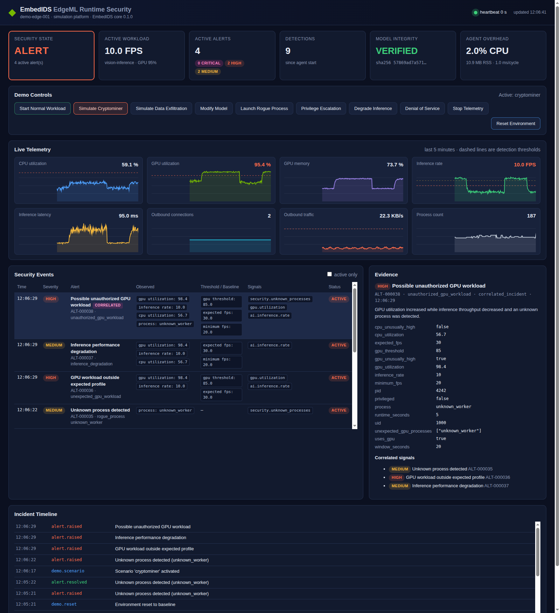

# EmbedIDS EdgeML Runtime Security (MVP)

EmbedIDS EdgeML (`embedids-edgeml`) is lightweight runtime threat detection
for Edge AI devices. It watches device behavior, AI workload health, network
activity and model integrity, and its detection rules are built around how
Edge AI workloads behave. It runs entirely in simulation today, and the same
detection engine is designed to move to NVIDIA Jetson by swapping collectors.



## Quick start

```bash
cd edgeml/deployment
docker compose up --build -d
open http://localhost:8080        # or xdg-open
```

Press **Simulate Cryptominer**, wait about 12 s, then click the correlated
alert. The full narrative is in [`docs/demo-guide.md`](docs/demo-guide.md).

Without Docker, the simulator runs inside the agent and the agent serves the
dashboard:

```bash
cmake -S . -B build -DBUILD_EDGEML=ON
cmake --build build -j
./build/edgeml/embedids-agent --config edgeml/configs/default.yaml   # from repo root
```

## What it detects

| Scenario | Alerts |
|----------|--------|
| Cryptominer / rogue GPU job | Unknown process; GPU workload outside expected profile; Inference degradation; **correlated: Possible unauthorized GPU workload** |
| Model tampering | **CRITICAL**: AI model integrity violation (expected vs current SHA-256) |
| Data exfiltration | Unknown destination (escalates to HIGH); Outbound traffic anomaly; Possible data exfiltration; Unexpected model file access; **correlated: Possible model/data exfiltration** |
| Privilege escalation | HIGH: Unauthorized privileged process (UID 0) |
| Denial of service | Resource exhaustion; Inference degradation |
| Agent / collector tampering | **CRITICAL**: Telemetry heartbeat lost; Configuration integrity violation |

Rules, thresholds and correlations are listed in
[`docs/architecture.md`](docs/architecture.md). All values are configurable
in YAML ([`configs/`](configs)).

## Components

| Path | Contents |
|------|----------|
| `core/` | Telemetry schema, config, SHA-256, the bridge to the EmbedIDS C core, detection rules, correlation |
| `collectors/` | Collector interface (HAL) with simulation, Linux `/proc`, and Jetson (tegrastats / sysfs) backends |
| `simulator/` | `edgeml-simulator`: Jetson-like vision workload, attack scenarios, HTTP control API, attack scripts |
| `agent/` | `embedids-agent`: pipeline, heartbeat, alert lifecycle and sinks (console / JSON / syslog / webhook), SQLite store |
| `api/` | REST API ([`docs/api.md`](docs/api.md)) and JSON schemas |
| `dashboard/` | Dependency-free dashboard and nginx proxy config |
| `configs/` | `default.yaml` (single process), `demo.yaml` (Docker), `linux-example.yaml`, `jetson-example.yaml` |
| `deployment/` | Dockerfile, `docker-compose.yml`, systemd unit |
| `tests/` | Unit, integration (virtual-clock scenarios, API, HTTP topology) and real-process attack scenarios |
| `docs/` | Architecture, demo guide, API, hardware porting guide, screenshots |

Dependencies are only for the agent and simulator; the EmbedIDS C library
stays dependency-free. The build fetches them with pinned SHA-256 hashes:

- nlohmann/json
- yaml-cpp
- cpp-httplib
- SQLite (the system copy if present, otherwise the amalgamation)

## Build and test

```bash
cmake -S . -B build -DBUILD_EDGEML=ON -DBUILD_TESTS=ON
cmake --build build -j
cd build && ctest --output-on-failure           # includes the ~3 min e2e run
ctest -E e2e                                    # unit + integration only (~5 s)
```

| CTest | Covers |
|-------|--------|
| `edgeml_unit_tests` | SHA-256 vectors, schema, config parsing, EmbedIDS signal engine, every rule, correlation, alert lifecycle, heartbeat timeout, file integrity, `/proc` and tegrastats parsers, simulator, SQLite store |
| `edgeml_integration_tests` | Every attack scenario end to end on a virtual clock with asserted alerts, severity and latency; 10 minutes of normal operation across 25 seeds with no alerts; REST API contract; agent and simulator over HTTP |
| `edgeml_e2e_attack_scenarios` | Real `edgeml-simulator` and `embedids-agent` processes, all scenarios through the REST API, plus JSON export and SQLite persistence |

To run the acceptance suite against the Docker stack:

```bash
python3 edgeml/tests/attack-scenarios/attack_scenarios.py --api http://localhost:8080/api
```

## Measured footprint

Measured in the Docker simulation at a 1 s sampling interval:

| Measure | Target | Measured |
|---------|--------|----------|
| CPU | < 5 % | ~0.5 % |
| Memory | < 100 MB | ~8-10 MB RSS |
| Processing latency per cycle | < 100 ms | ≤ 3 ms |
| Model tamper detection | < 2 s | 1 s |

## Status and limitations

- The Jetson collectors are written against documented L4T interfaces and
  their tegrastats parsing is unit-tested. They have **not** been validated
  on hardware yet; see [`docs/hardware-port.md`](docs/hardware-port.md).
- Detection is deterministic and threshold-based, as the MVP scope
  requires. Statistical baselines (EWMA, z-scores) are future work, and the
  trend algorithm in the core library is still a stub.
- On Linux, connections are not mapped to their owning process, because
  that would require `CAP_SYS_PTRACE`. Unexpected model-file reads are
  reported only by the simulation backend.
- Out of scope, as the spec defines: payload inspection, remediation, fleet
  management, and ML anomaly models.
